# Creality Flightdeck

**A local web dashboard for Creality K1-series printers, running on stock firmware with no root.**
It gives you a live camera, a G-code plate view, a 3D bed mesh, the CFS, full control, a file manager, overheat protection and alerts on your phone. It's all in a single HTML file that runs in your browser.

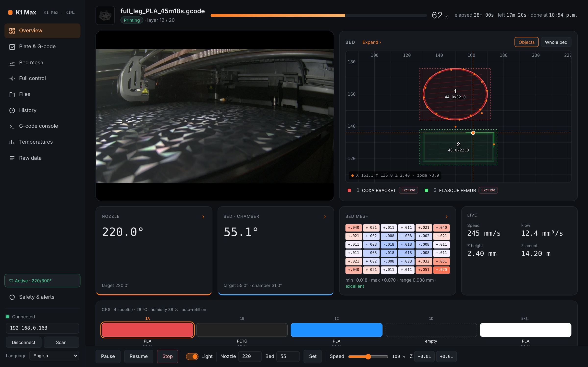

> ⚠️ **Unofficial project, not affiliated with Creality.** You use it at your own risk. Some commands move axes, heat up or delete files. Every physical action asks for a confirmation, but you are still in charge of your machine.
>
> 🌐 The interface is in **English** and **French**. By default it follows your browser's language (English otherwise). You can change it at the bottom of the sidebar: **Language → Auto / English / Français**.

---

## Table of contents

- [Features](#features)
- [Compatible printers](#compatible-printers)
- [Quick start](#quick-start)
- [Screenshots](#screenshots)
- [Overheat safety](#overheat-safety)
- [Phone alerts](#phone-alerts)
- [Repository layout](#repository-layout)
- [How it works](#how-it-works)
- [Known limitations & FAQ](#known-limitations--faq)
- [Credits](#credits)

---

## Features

**Monitoring**
- Live state, file, progress, layer, elapsed time, time left and ETA, plus a thumbnail of the current print.
- Nozzle, bed and chamber temperatures, with a 10-minute chart.
- Live camera (MJPEG on port 8080).
- Live speed, flow, Z height and filament used.
- Every field the printer sends, sorted by category, searchable and human-readable. Nested JSON is decoded.

**Plate & G-code**
- The plate is drawn with the objects being printed, their sizes, the nozzle position, and zoom/pan with millimetre rulers.
- **Load the `.gcode`** and you see the **real shapes layer by layer**: outer walls, inner walls and infill, one colour per object. Already-printed paths show in full colour, upcoming ones are faded, and the view follows the current layer.
- The **real layer is computed from Z**, because the stock firmware layer counter often drifts (e.g. `326 / 163`).
- **Exclude an object** while printing.
- A front-left marker shows the printer's orientation.

**Bed mesh**
- Read straight from the printer (`reqProbedMatrix`).
- **3D view** you can rotate and exaggerate, or a **2D heatmap** with the value of every point.
- Min, max and range, with a flatness grade.
- You can also import a `printer.cfg` `SAVE_CONFIG` block or a Moonraker JSON.

**CFS**
- Spool colour, type, vendor and remaining % for each slot (1A–1D plus the external spool), with the active slot highlighted.
- Box temperature and humidity, auto-refill state.
- Load or unload a slot, **drying**, auto-refill toggle.

**Control**
- Pause, resume and stop; light; nozzle and bed targets with presets; three fans; speed %.
- **Live Z-offset** (babystepping) and saving it.
- **Moves**: homing X/Y/Z and jogging (0.1 to 50 mm steps). Moves are blocked while printing.
- **Maintenance**: resume after a power loss, restart Klipper, restart the firmware, clear the bed mesh, clear an error.
- A **sticky action bar**, always visible.

**Files & history**
- The G-code files on the printer, with thumbnails. **Print**, **rename** and **delete** them.
- **Upload a G-code from your PC** by drag & drop.
- **Print history** with total print time.

**G-code console**
- Sends any command (`gcodeCmd`), with command history and shortcuts.
- Heating commands above your safety limits are **refused**.

**Safety & alerts**
- An **overheat watchdog**: stops the print and cuts the heaters (see below).
- **Phone alerts** through [ntfy](https://ntfy.sh), your own server, e-mail or SMS, with a **snapshot** of the camera, the plate and the temperatures.
- An alert if the connection drops during a print.

**Quality of life**
- **English / French interface**: auto-detected, with a setting in the sidebar.
- **Auto network scan** when the printer's IP changes (DHCP).
- Responsive layout: sidebar on desktop, stacked on a phone.
- No install, no server and no account: one HTML file.

---

## Compatible printers

The dashboard talks to the **stock Creality OS WebSocket API on port 9999**. That API is shared by Creality's Klipper-based line.

| Printer | Status | Notes |
|---|---|---|
| **K1 Max** (firmware 2.3.5.34, with CFS) | ✅ **Tested** | Developed and tested on this machine |
| K1 / K1C / K1 SE | 🟡 Should work | Same API. The plate size (220 mm) is not auto-detected yet |
| K2 Plus / K2 Pro | 🟡 Partial | The API is similar, but the camera uses **WebRTC** (not supported yet) and the plate size differs |
| Ender-3 V3 / V3 KE, Creality Hi | 🟡 Untested | Reported to use the same WebSocket |
| Marlin-based Creality (Ender-3 V2/S1, CR-10…) | ❌ No | No network API |

Rooted printers (Moonraker/Fluidd) keep the port-9999 API, so the dashboard still works there. The bed mesh importer also reads Moonraker JSON.

If you try it on another model, please open an issue with your result. A copy of the "Données brutes" (raw data) JSON helps a lot.

---

## Quick start

**Requirements:** a computer on the **same network** as the printer, and a modern browser (Chrome, Edge or Firefox).

1. **Download** [`creality-flightdeck.html`](creality-flightdeck.html), or clone the repo.
2. **Open it** in your browser by double-clicking the file. It runs from `file://` and needs no web server.
3. **Connect**: type your printer's IP at the bottom of the sidebar (you'll find it on the printer's screen, under network settings) and click **Connecter**. Or click **Scanner** to find the printer on your network.

That's it. The IP and all your settings are remembered in the browser.

> **Why a local file and not a website?** Browsers block web pages served over HTTPS from talking to devices on your local network. A local file is allowed to open `ws://<printer-ip>:9999`.

**Tips**
- Give your printer a **DHCP reservation** (a fixed IP) in your router. The page can scan for it, but a fixed IP is faster.
- Load the print's `.gcode` (Plateau & G-code → *Charger le G-code…*, or drag it onto the plate) for the real shapes and the real layer number.
- Safety and alerts only run **while the page is open** (see below).

---

## Screenshots

*The camera image and the print thumbnail are real (K1 Max). The other values are demo data.*

| | |
|---|---|
| 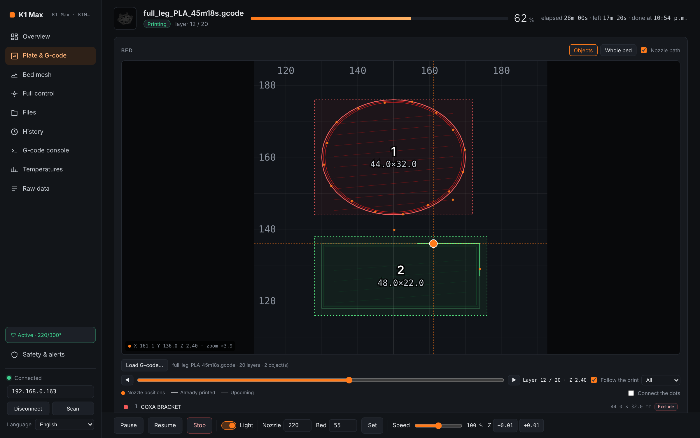 **Plate & G-code**: real walls and infill from the G-code, printed vs upcoming paths | 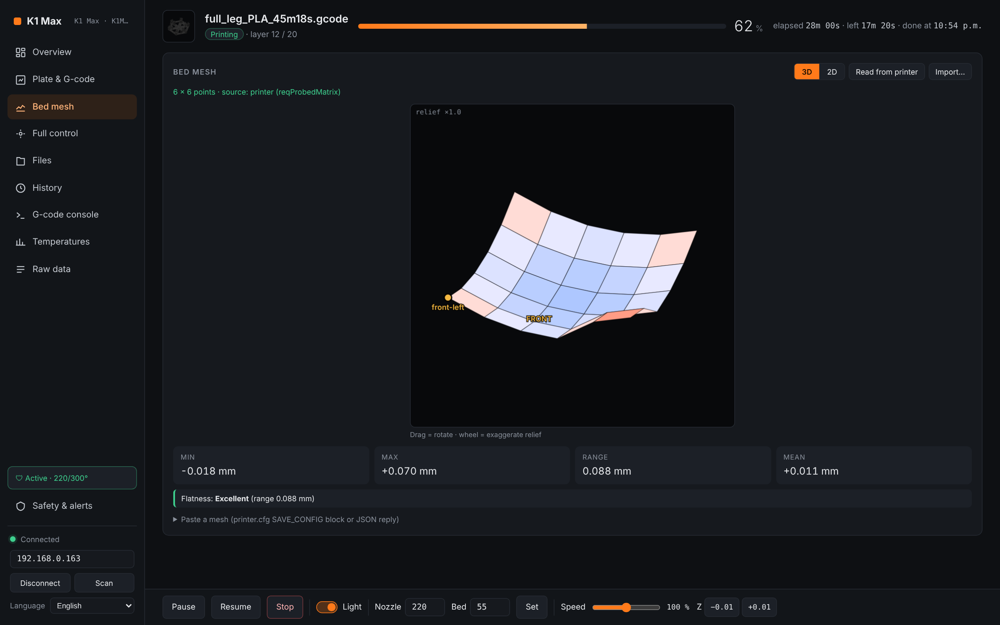 **Bed mesh**: 3D view (rotate, exaggerate) |
| 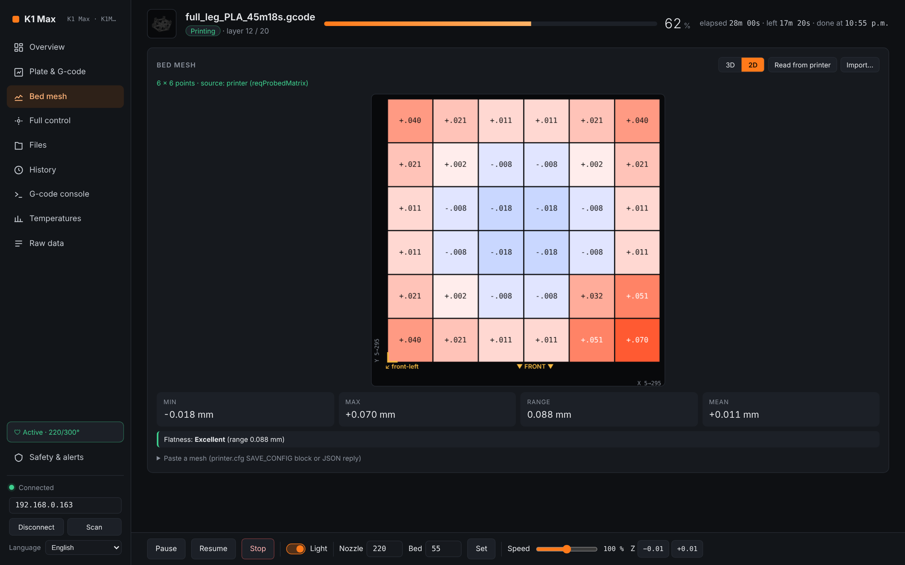 **Bed mesh 2D**: every probed value | 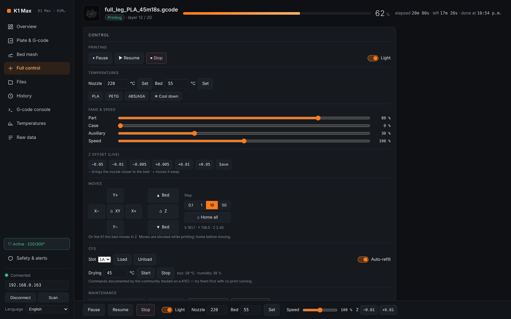 **Full control**: temps, fans, Z-offset, moves, CFS, maintenance |
| 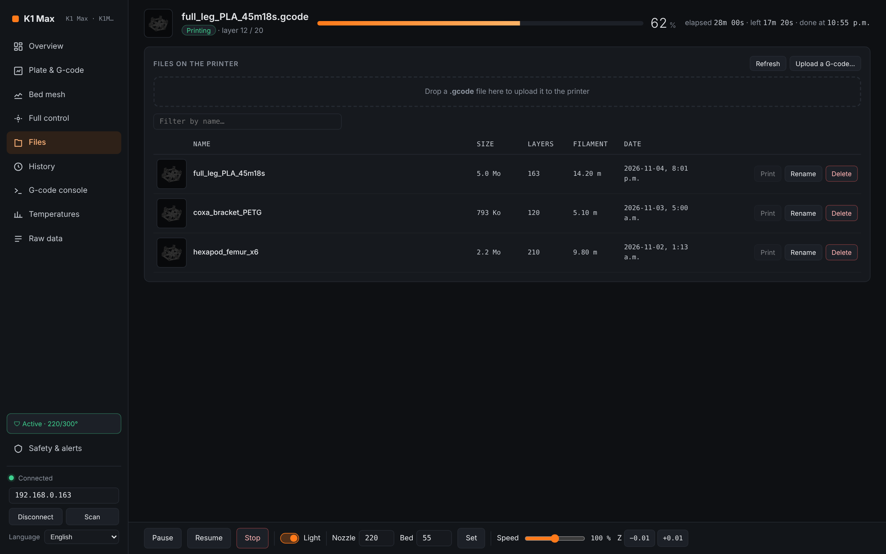 **Files**: thumbnails, print/rename/delete, drag & drop upload | 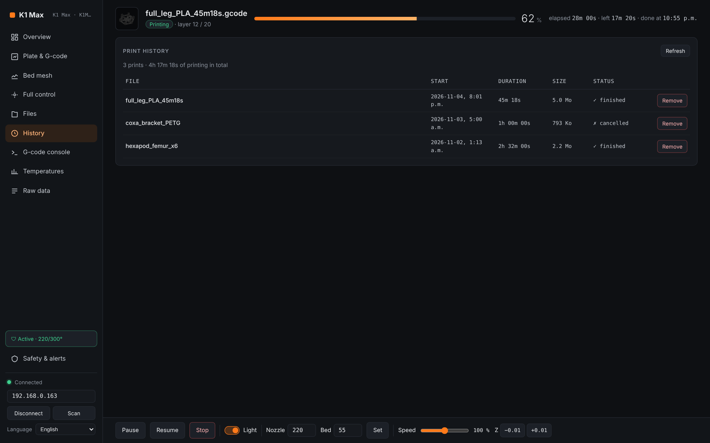 **History** |
| 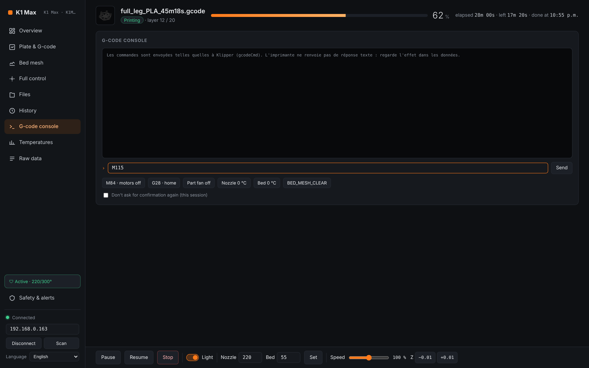 **G-code console** | 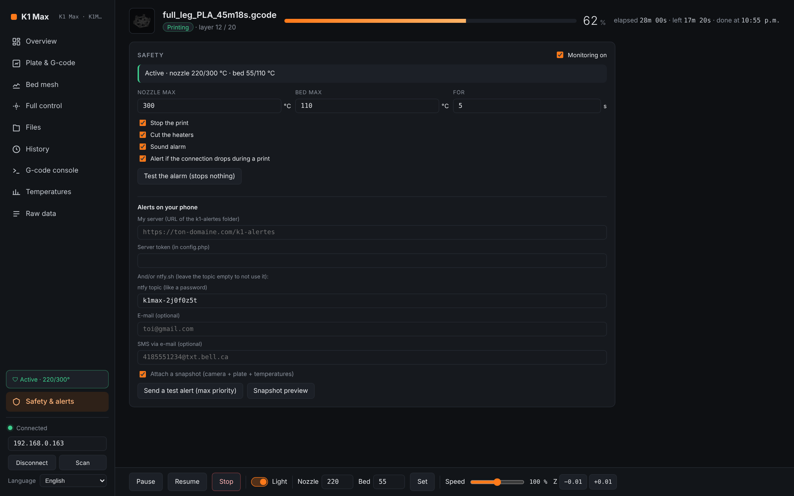 **Safety & alerts** |
| 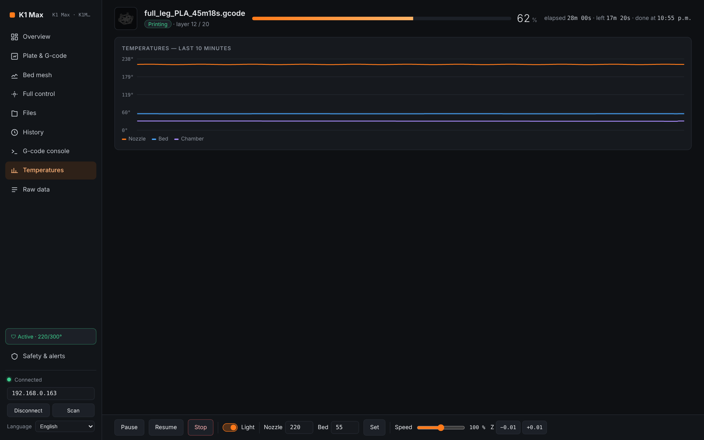 **Temperatures** | 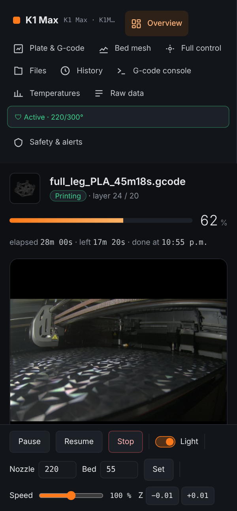 **Mobile layout** |

---

## Overheat safety

In **Sécurité & alertes**, a watchdog checks the temperatures on every update:

- If the **nozzle ≥ 300 °C** or the **bed ≥ 110 °C** for more than **5 seconds** (all three values are configurable), it:
  1. sends **stop** (`{"method":"set","params":{"stop":1}}`),
  2. **cuts the heaters** (`nozzleTempControl: 0`, `bedTempControl: {num:0, val:0}`, plus `M104 S0` / `M140 S0`), and resends that every 5 s while still hot,
  3. shows a red banner, plays a sound, sends a Windows notification and a **phone alert**.
- It can also alert you when the connection drops during a print.
- *Tester l'alarme* tests the alarm without sending anything to the printer.

**Be honest with yourself about what this protects:**
- It works **only while the page is open**, on a computer that is on and connected.
- Klipper's own protections (max temperature, heater verification) remain the **first line of defence**. This is a second layer.
- Software can't help if a heater MOSFET fails stuck-on. Only cutting the power does that: put the printer on a **smart plug** (Shelly, Tasmota, etc.).

---

## Phone alerts

When an alert triggers, the page can notify you through any combination of these, with an optional **snapshot** (camera + plate + temperatures).

### Option A: ntfy (easiest)
1. Install the **ntfy** app ([Android](https://play.google.com/store/apps/details?id=io.heckel.ntfy) / [iOS](https://apps.apple.com/app/ntfy/id1625396347)).
2. In *Sécurité & alertes*, copy the generated **ntfy topic** (e.g. `k1max-xxxxxxxx`) and subscribe to it in the app. Treat the topic like a password.
3. Click *Envoyer une alerte test*.

Optional: fill in an **e-mail** address, or an **e-mail-to-SMS** gateway such as `5551234567@txt.bell.ca`, and ntfy will forward the alert there.

To make alerts ring on Android **even on vibrate**: in the ntfy app settings, turn on the option to keep alerting for the highest priority, and let the *Max priority* channel override Do Not Disturb.

### Option B: your own server (PHP / cPanel)
The [`server/`](server/) folder is a small, self-hosted alert relay:
- **Web Push to Android through Chrome**, with no app to install. The phone page installs as a PWA.
- **E-mail** with the snapshot attached, and **SMS** through your carrier's e-mail gateway.
- A secret token, a rate limit, and a data folder that can't be reached from the web.

Setup: upload `server/` to e.g. `public_html/k1-alertes/`, copy `config.example.php` to `config.php` and set your token and e-mail, open the page on your phone and tap *Activer les notifications*. Then enter the URL and token in the dashboard. Full steps are in [`server/INSTALLATION.txt`](server/INSTALLATION.txt).

Requirements: PHP 7.4+ with `openssl` and `curl`, and HTTPS.

> Web Push notifications can't play sound on vibrate on Android. For loud alarms, use ntfy (you can use both).

---

## Repository layout

```
creality-flightdeck.html   ← the dashboard (single file, open it in your browser)
server/                    ← optional self-hosted alert relay (PHP, Web Push, e-mail, SMS)
tools/
  k1_monitor.py            ← minimal terminal monitor (Python, read-only)
  lancer_k1.bat            ← Windows launcher for k1_monitor.py
  k1_explore.ps1 / .bat    ← read-only: records what the printer sends and downloads its web UI
  k1_probe.ps1 / .bat      ← read-only: sends the documented "get" requests and logs the replies
docs/
  API.md                   ← the Creality WebSocket/HTTP API as used here
  screenshots/
```

The `tools/` scripts are handy for adding support for a new model. They only **read**: they never heat, move or start anything.

---

## How it works

```
Browser (local file) ──ws://IP:9999──▶ Creality OS (status push + "get"/"set" commands)
                     ──http://IP:80───▶ file thumbnails, current print image, G-code upload
                     ──http://IP:8080─▶ camera (MJPEG)
                     ──https──────────▶ ntfy.sh and/or your own alert server (optional)
```

- The printer **pushes** status deltas as JSON. The page merges them into one state.
- Data that only arrives on request is asked for with `{"method":"get","params":{...:1}}`: bed mesh, files, history, objects, CFS.
- Commands use `{"method":"set","params":{...}}`, in the **exact formats used by the printer's own web interface** (read from its `app.js`).
- The page replies `ok` to the printer's `heart_beat`.

The full list of requests and commands is in **[docs/API.md](docs/API.md)**.

---

## Known limitations & FAQ

- **Does it need root?** No. It's built for stock firmware.
- **The layer counter shows `326 / 163`.** That's the stock firmware double-counting. Load the G-code and the page computes the real layer from Z.
- **The camera shows "non disponible".** The page tries `http://IP:8080/?action=stream`. Some firmwares or models (K2) use another URL or WebRTC.
- **"Lire l'imprimante" finds no bed mesh.** The printer only answers once a mesh exists. Run an auto-level first.
- **The CFS tile doesn't appear.** The CFS commands come from community docs tested on a K1C. Your firmware may not expose `boxsInfo`.
- **Uploading files.** The printer sends no CORS headers, so the page can't read the upload reply. It confirms the upload by checking the file list afterwards.
- **My antivirus sandboxed the `tools/` scripts.** Some antiviruses (e.g. Comodo auto-containment) redirect their output to a virtual folder such as `C:\VTRoot\…`. Add the folder to your trusted list.
- **Everything stops when I close the tab.** Yes, it's a web page. For 24/7 monitoring, keep it open on an always-on computer, or root the printer and use Moonraker-based tools.

---

## Roadmap

- Auto-detect plate size per model (K1/K1C 220 mm, K2 Plus 350 mm…)
- K2 WebRTC camera
- Smart plug integration (Shelly/Tasmota) to cut power on alarm

---

## Credits

- Built by [Floriantoine](https://github.com/Floriantoine) for his K1 Max, with help from Claude.
- Protocol details cross-checked with the community:
  [creality-cfs-panel](https://github.com/sandman21vs/creality-cfs-panel),
  [ha_creality_ws](https://github.com/3dg1luk43/ha_creality_ws),
  [3d-cli #93](https://github.com/alex-mextner/3d-cli/issues/93),
  [OrcaSlicer #8193](https://github.com/OrcaSlicer/OrcaSlicer/issues/8193).

*Creality, K1, K1 Max, K2 and CFS are trademarks of their respective owners. This project is not affiliated with or endorsed by Creality.*
